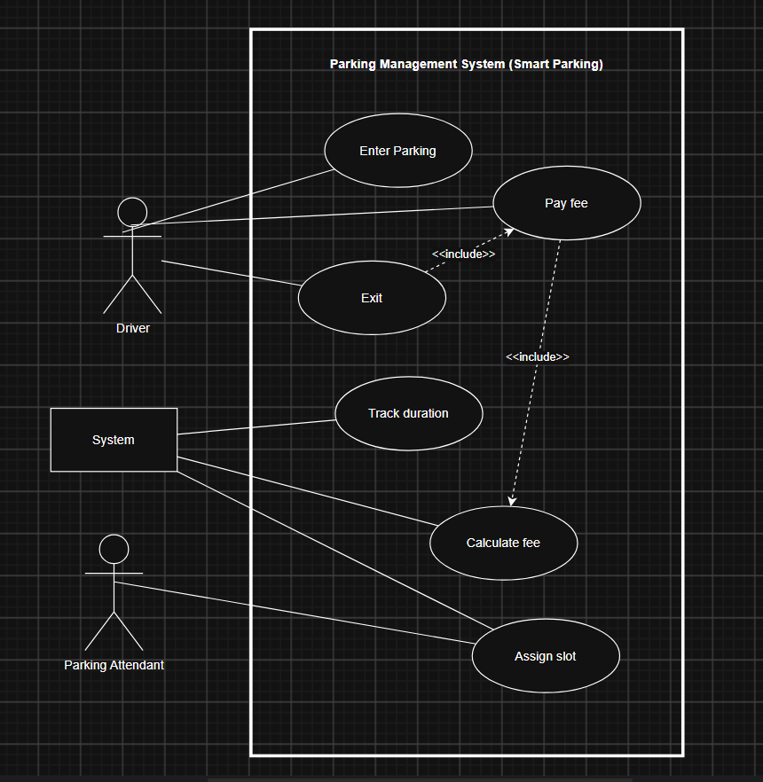
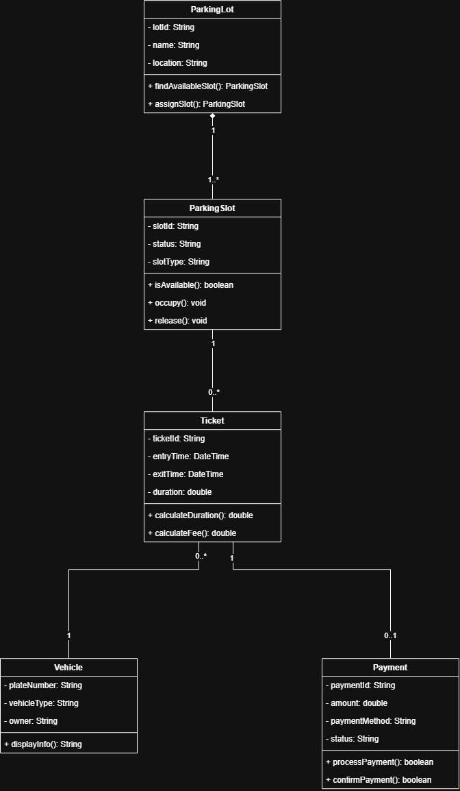
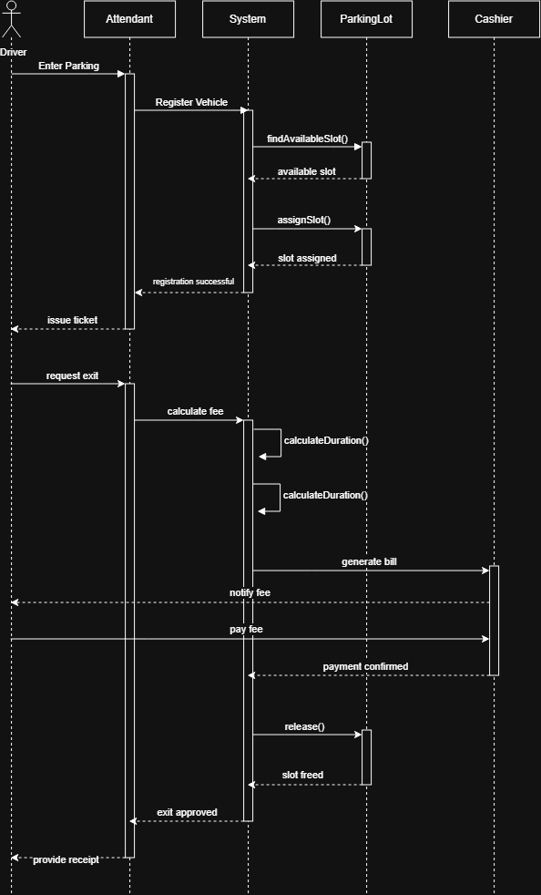
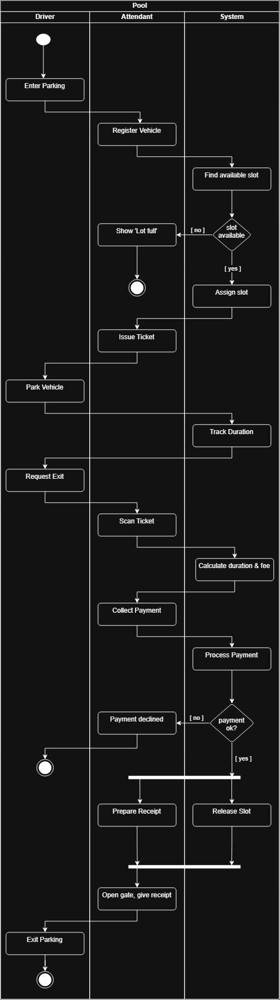

# Parking Management System (Smart Parking)

## Project Description

The **Parking Management System (Smart Parking)** is a web-based parking management solution designed to help parking facilities such as malls, commercial establishments, and managed parking areas handle vehicle entry, slot assignment, parking duration tracking, fee calculation, payment, and vehicle exit.

The system is intended to reduce manual parking operations and make parking transactions more organized, accurate, and easier to monitor. Drivers do not need to create accounts or log in. Parking operations are handled through the system by authorized parking personnel or administrators.

The project follows object-oriented design principles and uses a layered architecture in the backend to separate request handling, business logic, and database access.

## Objectives

The project aims to:

- Provide an organized way to register vehicles entering the parking area.
- Automatically identify and assign an available parking slot.
- Track the duration of each active parking session.
- Calculate parking fees based on the configured parking rates.
- Record payment information and release parking slots after checkout.
- Allow parking personnel to monitor active parking sessions and slot availability.
- Provide a configurable parking lot layout and parking rate settings.
- Apply object-oriented programming principles through well-defined classes, responsibilities, and relationships.
- Maintain parking records using a relational database.

## Target Users / Stakeholders

The primary users and stakeholders of the system are:

- **Driver** – enters the parking facility, receives a parking ticket, pays the required fee, and exits.
- **Parking Attendant / Administrator** – operates and manages the parking system, monitors available and occupied slots, processes parking transactions, and manages parking configuration.
- **Parking Management** – benefits from organized records, parking utilization information, and payment tracking.
- **System** – performs automated processes such as slot assignment, duration tracking, fee calculation, and slot release.

## Key Features

### Vehicle Entry

- Register the vehicle plate number and vehicle type.
- Find an available parking slot based on the required slot type.
- Assign the selected parking slot.
- Mark the assigned slot as occupied.
- Generate a parking ticket with an entry timestamp.

### Parking Slot Management

- Display available and occupied parking slots.
- Support different slot types such as:
  - Standard
  - Motorcycle
  - PWD
- Mark unavailable slots as out of service.
- Release parking slots after a completed parking transaction.

### Active Parking Sessions

- Display active parking tickets.
- Show the assigned slot, vehicle plate number, ticket number, and parking duration.
- Allow parking personnel to locate and monitor active sessions.

### Duration and Fee Calculation

- Track parking duration using the recorded entry and exit times.
- Calculate the parking fee based on configured rates.
- Support a configurable first-hour rate.
- Support a configurable succeeding-hour rate.
- Detect vehicles that have exceeded the configured overstay threshold.

### Payment and Checkout

- Support payment methods such as:
  - Cash
  - GCash
  - Card
- Generate a receipt number for successful payments.
- Mark the parking ticket as completed after successful payment.
- Record the exit time.
- Release the assigned parking slot for reuse.

### Lot Configuration

- Configure the parking slot layout.
- Configure parking slot types.
- Configure first-hour and succeeding-hour rates.
- Configure the overstay threshold.
- Manage unavailable or closed parking slots.

### Administration

- Authorized administrators can manage and monitor parking operations.
- Drivers/customers do not need to create an account or log in.

## Technology Stack

### Backend

- **Java 17**
- **Spring Boot**
- **Spring Web**
- **Spring Data JPA**
- **Hibernate**
- **Maven**

### Frontend

- **React**
- **TypeScript**
- **Vite**

### Database

- **MySQL**
- **MySQL Workbench**

### Development Tools

- **IntelliJ IDEA**
- **Postman**
- **Git / GitHub**
- UML diagramming tool used for system design

## System Architecture

The backend follows a layered architecture:

```text
React Frontend
      |
      | HTTP / JSON
      v
Controller
      |
      v
Service
      |
      v
Repository
      |
      v
MySQL Database
```

### Layer Responsibilities

- **Controller** – receives HTTP requests and returns API responses.
- **Service** – contains the business logic of the parking system.
- **Repository** – handles database access through Spring Data JPA.
- **Entity** – represents persistent domain data stored in MySQL.
- **DTO** – represents request and response data exchanged through the API.

## Project Structure

A simplified project structure is shown below:

```text
parking-management/
|
|-- backend/
|   |-- src/
|   |   |-- main/
|   |   |   |-- java/
|   |   |   |   `-- com/parking/management/
|   |   |   |       |-- controller/
|   |   |   |       |-- dto/
|   |   |   |       |-- entity/
|   |   |   |       |-- enums/
|   |   |   |       |-- repository/
|   |   |   |       |-- service/
|   |   |   |       `-- ParkingManagementApplication.java
|   |   |   `-- resources/
|   |   |       `-- application.properties
|   |   `-- test/
|   |-- pom.xml
|   |-- mvnw
|   `-- mvnw.cmd
|
|-- frontend/
|   |-- src/
|   |   |-- components/
|   |   |-- pages/
|   |   |-- services/
|   |   |-- types/
|   |   |-- App.tsx
|   |   `-- main.tsx
|   |-- package.json
|   `-- vite.config.ts
|
|-- docs/
|   `-- uml/
|       |-- use-case-diagram.png
|       |-- class-diagram.png
|       |-- sequence-diagram.png
|       `-- activity-diagram.png
|
`-- README.md
```

> **Note:** The exact folder structure may change as development continues. The repository should still keep the source code, documentation, UML files, configuration files, and README organized.

## Core Domain Classes

The current system design is centered around the following major domain concepts:

- **ParkingLot** – represents the parking facility and its parking configuration.
- **ParkingSlot** – represents an individual parking space and its current status/type.
- **Vehicle** – stores vehicle information such as plate number and vehicle type.
- **Ticket** – represents a parking session, including entry time, exit time, assigned slot, and ticket status.
- **Payment** – represents payment information associated with a parking ticket.
- **Administrator** – represents an authorized system administrator account.

Supporting enums are used for values such as slot status, slot type, vehicle type, ticket status, payment method, and payment status.

## Setup / Execution Instructions

### Prerequisites

Before running the project, install:

- Java 17
- IntelliJ IDEA or another Java IDE
- Maven, or use the included Maven Wrapper
- MySQL Server
- MySQL Workbench
- Node.js and npm
- Postman (optional, for API testing)

### 1. Clone the Repository

```bash
git clone <repository-url>
cd parking-management
```

Replace `<repository-url>` with the actual GitHub repository URL.

### 2. Create the MySQL Database

Open MySQL Workbench and execute:

```sql
CREATE DATABASE parking_management;
```

### 3. Configure the Backend Database Connection

Open:

```text
backend/src/main/resources/application.properties
```

Configure the MySQL connection:

```properties
spring.application.name=parking-management

spring.datasource.url=jdbc:mysql://localhost:3306/parking_management
spring.datasource.username=root
spring.datasource.password=YOUR_MYSQL_PASSWORD

spring.jpa.hibernate.ddl-auto=update
spring.jpa.show-sql=true
spring.jpa.properties.hibernate.format_sql=true
```

Replace `YOUR_MYSQL_PASSWORD` with the local MySQL password.

> Do not commit real database passwords to a public repository. Environment variables should be used for credentials when the project is prepared for deployment.

### 4. Run the Spring Boot Backend

From IntelliJ IDEA, run:

```text
ParkingManagementApplication.java
```

Or from the backend directory:

```bash
./mvnw spring-boot:run
```

On Windows:

```bash
mvnw.cmd spring-boot:run
```

The backend normally runs at:

```text
http://localhost:8080
```

### 5. Run the React Frontend

From the frontend directory:

```bash
npm install
npm run dev
```

The Vite development server normally runs at:

```text
http://localhost:5173
```

### 6. Example API Test

Example vehicle entry request:

```http
POST /api/parking/entry
```

Example JSON body:

```json
{
  "plateNumber": "ABC 1234",
  "vehicleType": "CAR",
  "slotType": "STANDARD"
}
```

The backend assigns an available slot, marks the slot as occupied, and creates an active parking ticket.

## UML Diagrams

The project includes the required UML design artifacts. The diagram files should be stored inside:

```text
docs/uml/
```

### Use Case Diagram

The Use Case Diagram identifies the major actors and the primary functions of the Smart Parking system, including parking entry, slot assignment, duration tracking, fee calculation, payment, and vehicle exit.



### Class Diagram

The Class Diagram represents the core object-oriented design of the system, including the relationships among `ParkingLot`, `ParkingSlot`, `Vehicle`, `Ticket`, and `Payment`.



### Sequence Diagram

The Sequence Diagram illustrates the interactions among the driver, parking attendant, system, parking lot, and cashier during vehicle entry, parking slot assignment, fee calculation, payment, and exit processing.



### Activity Diagram

The Activity Diagram illustrates the complete parking workflow from vehicle entry to vehicle exit. It includes alternate paths for unavailable parking slots and declined payments.



## Current Development Status

Development has officially begun.

Current progress includes:

- Spring Boot project initialized.
- Core entities and enums created.
- Repository layer created using Spring Data JPA.
- Service layer for parking, tickets, slots, vehicles, and payments started.
- REST controllers created for major parking operations.
- MySQL database connected successfully.
- Hibernate/JPA table generation verified.
- Vehicle entry and parking slot assignment tested through Postman.
- Payment, checkout, and slot release workflow implemented for backend testing.
- React + TypeScript + Vite selected for frontend development.
- UML design artifacts prepared.

A fully working system is not required at this stage; development will continue throughout the capstone.

## Planned Improvements

The following features may be refined or implemented as development progresses:

- Complete React user interface integration.
- Dashboard statistics and parking utilization summaries.
- Lot configuration persistence and slot management controls.
- Administrator authentication and authorization.
- Cleaner API response DTOs.
- Global exception handling and validation.
- Additional testing for parking, payment, and configuration workflows.

## Contributors

Add the project members here if applicable.

```text
Name - Role
```

## Academic Purpose

This project is developed as an academic capstone requirement to demonstrate object-oriented analysis, UML modeling, software architecture, and implementation using an OOP-capable technology stack.
